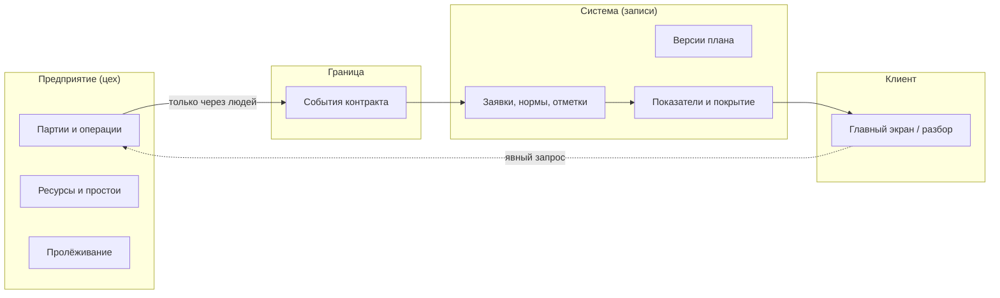
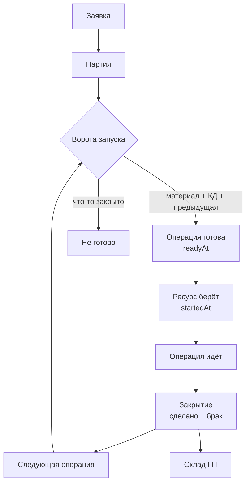
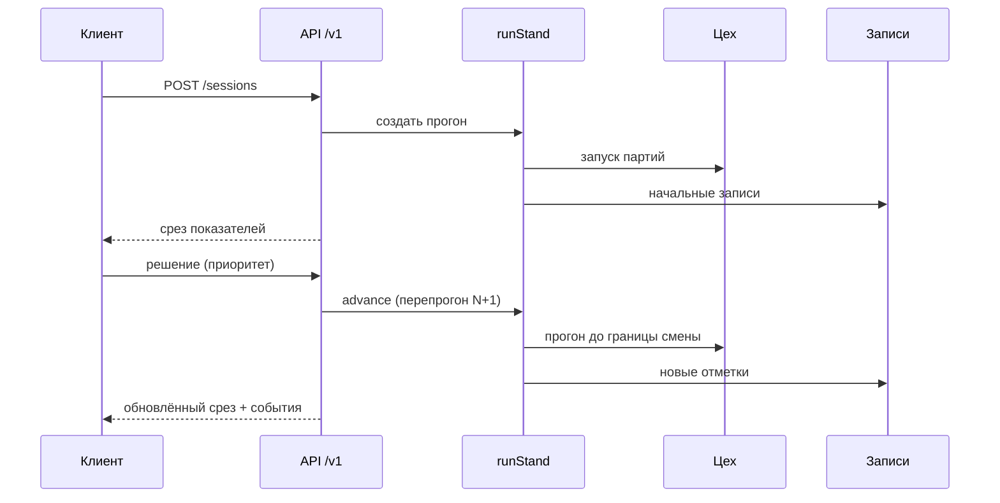

# Карта потоков данных

**Актуализация:** 2026-11-27  
**Назначение:** как данные движутся в модели предприятия, в Системе и между ними.

Связанные документы:
- Глоссарий: [`README_GLOSSARY.md`](README_GLOSSARY.md)
- Модель стенда: [`../SIM/README_SIM_DATA.md`](../SIM/README_SIM_DATA.md)
- Реконструкция карты потоков производства: [`README_MAP_RECONSTRUCTION.md`](README_MAP_RECONSTRUCTION.md)

---

## 1. Три мира и граница

**Правило:** показатели читают только записи. Состояние цеха им недоступно.  
Правда цеха появляется только в режиме разбора.

---

## 2. Поток внутри предприятия

**Ключевые моменты:**
- `readyAt` ставится в момент открытия последнего ворот.
- `startedAt` ставится, когда ресурс взял операцию.
- Пролёживание = разница этих моментов.
- Сейчас операция закрывается целиком. Частичное закрытие — в спеке `sim-shop-rules`.

---

## 3. Поток записей в Системе

Отметки могут:
- прийти сразу;
- прийти со сдвигом (уровень `late`);
- не прийти вовсе (уровень `paper` / пропуск).

Покрытие показывает, на какой доле записей показатель реально собран.

---

## 4. Поток через API

Сессия хранит параметры и решения, а не изменяемое состояние цеха.  
Каждый срез — результат перепрогона.

---

## 5. Что видно на разных слоях

| Слой | Что видит | Откуда данные |
|------|-----------|---------------|
| Цех | Партии, ресурсы, пролёживание, простои | `PlantState` |
| Записи | Заявки, нормы, отметки, версии плана | `SystemRecords` |
| Свод | 4 показателя + покрытие | только записи |
| Разбор | Сравнение «что видел» ↔ «что было» | оба мира по запросу |

---

## 6. Узкие места данных (текущие)

| Место | Что происходит | Статус |
|-------|----------------|--------|
| Печь | Каждая партия занимает садку целиком | Упрощение (спека меняет) |
| Закрытие операции | Только целиком | Упрощение (спека меняет) |
| Брак | Константа на токарной | Упрощение (спека меняет) |
| Новые заявки | Не появляются во время прогона | Не входит в текущую модель |
| Телеметрия ЧПУ | Нет | Вне контракта |

---

## Связанные спеки

- Пролёживание и узкое место: `openspec/changes/sim-waiting-time`
- Садка, частичное закрытие, контроль: `openspec/changes/sim-shop-rules`
- API-контракт: `openspec/changes/sim-api-contract`
