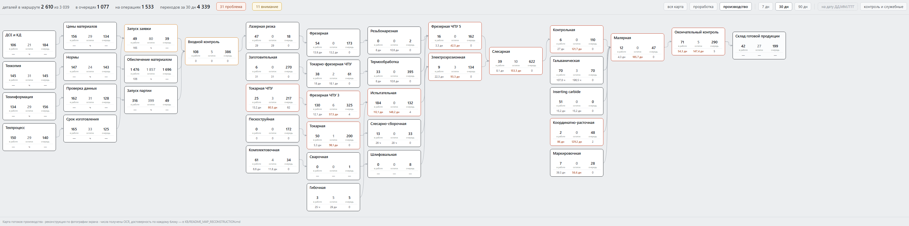

# Реконструкция: «Карта потоков производства»

**Актуализация:** 2026-11-25

> **Источник изображения:** `Производственная карта.jpg` _(файл хранится во внутреннем архиве, вне репозитория)_ — **фотография экрана монитора SAMSUNG** (не скриншот). Снято с рук, содержимое занимает лишь полосу 18–89% высоты кадра, схема — 38–63%. Отсюда низкое разрешение текста.
>
> **Метод:** OCR (Tesseract rus+eng) + vision-модель, две независимые проверки. Названия блоков распознаны устойчиво, числа — **с неуверенностью**, отмечено явно.
>
> **Кто смотрит экран:** руководство. Раздел системы — «производство», вкладка «Карта потоков».

---



> Диаграмма воспроизводит экран по фотографии: 13 колонок этапов, 40 карточек,
> изогнутые связи, шапка с фильтрами. Числа внутри карточек — результат OCR
> с оценкой достоверности (см. таблицы ниже). Источник HTML-вёрстки: `_map/map.html`.

## Почему блоки непонятны — это зафиксировано в документах

Легенды на экране **нет**. Это не дефект снимка, а **известный пробел**, зафиксированный как критерий приёмки:

> **Зона А5** (дорожная карта): «Единицы измерения и периоды показателей не сведены в одно место». Мероприятие: «Легенда к экрану и карте: что в н/ч, штуках, партиях, за какой период, на какую дату». **Критерий приёмки: «Легенда есть на экране и в документе».**

То есть отсутствие легенды — **признанная зона неопределённости А5**, а не ваша ошибка чтения.

---

## Что означает карточка (семантика восстановлена по документам)

Структура узла описана в правилах представления управленческой статистики:

> «На **узле**: количество, оставшаяся работа, ожидание; на **переходе**: переданный объём за период».

Отсюда три числа в верхней строке карточки и два-три значения внизу:

| Позиция | Что означает | Единица |
|---------|--------------|---------|
| **Число 1** (левое) | **Количество** — сколько деталей/партий стоит на операции сейчас | штуки деталей |
| **Число 2** (среднее) | **Оставшаяся работа** — сколько ещё предстоит выполнить | н/ч или шт. |
| **Число 3** (правое) | **Очередь** — работа, готовая к исполнению, но не поставленная в период | шт. |
| **Значение внизу, левое** | Фактическое **ожидание** (сколько уже стоит) | дни / часы |
| **Значение внизу, среднее** | **Нормативное** или плановое время | дни / часы |
| **Число внизу справа** | Отклонение / превышение | — |

> ⚠️ **Это реконструкция по документам, а не прочитанная легенда.** Проверить на живой системе.

---

## Шапка экрана: сводная статистика

| Показатель | Значение | Достоверность |
|-----------|----------|---------------|
| Деталей в маршруте | **2 610** из ~3 039 наименований | средняя (число 2 610 подтверждено дважды) |
| Из них в очередях | **1 077** (по другому прогону — 1 677) | ⚠️ **расхождение** |
| На операциях | **1 533** | высокая (подтверждено дважды) |
| Переходов за 30 дней | **4 339** | высокая (подтверждено дважды) |
| Проблем | **11** или **31** | ⚠️ **расхождение** |
| Внимание | **11** | средняя |

Ещё в шапке: переключатели `вся карта / проработка / производство`, периоды `7 дн / 30 дн / 90 дн`, поле `на дату ДД.ММ.ГГГГ`, кнопка `контроль и служебные`.

> ⚠️ **Расхождения по «проблемам» (11 vs 31) и «в очереди» (1 077 vs 1 677)** — следствие качества снимка. Проверять по системе, не по фотографии.

---

## Структура схемы

Карта читается **слева направо** по этапам, карточки соединены серыми линиями связей.

```
[Этап 1: Подготовка]  →  [Этап 2: Данные]  →  [Этап 3: Запуск]  →
[Этап 4: Контроль]    →  [Этап 5-9: Операции участков]  →  [Склад ГП]
```

### Этап 1 — Подготовка документации
| Блок | Числа (верх / низ) | Достоверность |
|------|-------------------|---------------|
| ДСЕ и КД | 106 · 21 · 184 | средняя |
| Техкопия | 145 · 31 · 145 | средняя |
| Техинформация | 134 · 29 · 156 | средняя |
| Техпроцесс | 150 · 29 · 140 | средняя |

### Этап 2 — Данные и нормирование
| Блок | Числа | Достоверность |
|------|-------|---------------|
| Цены материалов | 156 · 29 · 134 | средняя |
| Нормы | 147 · 24 · 143 | средняя |
| Проверка данных | 162 · 31 · 128 | средняя |
| Срок изготовления | 165 · 33 · 125 | средняя |

### Этап 3 — Запуск и обеспечение
| Блок | Числа верх | Число низ | Достоверность |
|------|-----------|-----------|---------------|
| Запуск заявки | 49 · 80 · 39 | 165 | средняя |
| Обеспечение материалом | 1 476 · 1 857 · 1 696 | 106 | средняя |
| Запуск партии | 316 · 399 · 49 | — | средняя |

### Этап 4 — Контроль
| Блок | Числа | Достоверность |
|------|-------|---------------|
| Входной контроль | 108 · 5 · 386 / 0 · 0 · 0 | средняя |

---

## Этап 5–9 — Участки производства

Это **основная часть карты** и именно она вызывает вопросы. Список участков совпадает с перечнем в документах системы (26 участков, на фото видны не все).

| Участок | Числа верх | Время (дн/ч) | Достоверность |
|---------|-----------|--------------|---------------|
| Лазерная резка | 47 · 0 · 18 | 29 ч · 29 ч · 0 | средняя |
| Заготовительная | 6 · 0 · 270 | 31 ч · 31 ч · 0 | средняя |
| Токарная ЧПУ | 25 · 3 · 217 | **13,2 дн · 80,5 дн** · 62 | высокая |
| Пескоструйная | 0 · 0 · 172 | 0 · 0 · 0 | средняя |
| Комплектовочная | 61 · 4 · 34 | **6,6 дн · 11,8 дн** · 0 | высокая |
| Гибочная | 3 · 5 · 5 | 25 ч · 29 дн · 0 | низкая |
| Фрезерная | 54 · 0 · 173 | **13,9 дн · 13,2 дн** · 0 | высокая |
| Токарно-фрезерная ЧПУ | 38 · 2 · 61 | **18 дн · 18,1 дн** · 0 | высокая |
| Фрезерная ЧПУ 3 | 130 · 6 · 325 | **12,1 дн · 57,5 дн** · 4 | высокая |
| Токарная | 50 · 1 · 200 | **5,3 дн · 98,1 дн** · 0 | высокая |
| Сварочная | 0 · 0 · 1 | — | средняя |
| Резьбонарезная | 0 · 0 · 2 | 8 дн · 10,6 дн · 0 | средняя |
| Термообработка | 33 · 0 · 395 | **8 дн · 10,6 дн** · 0 | высокая |
| Испытательная | 184 · 0 · 132 | **112,1 дн · 148,2 дн** · 4 | высокая |
| Слесарно-сборочная | 13 · 0 · 33 | 26 ч · 28 ч · 0 | средняя |
| Шлифовальная | 0 · 0 · 8 | — | средняя |
| Фрезерная ЧПУ 5 | 16 · 0 · 162 | **3,3 дн · 42,5 дн** · 0 | высокая |
| Электроэрозионная | 9 · 3 · 134 | **22,3 дн · 93,3 дн** · 0 | высокая |
| Слесарная | 39 · 10 · 622 | **8,1 дн · 153,3 дн** · 0 | высокая |
| Контрольная | 6 · 0 · 110 | **27 дн · 121,7 дн** · 0 | высокая |
| Гальваническая | 70 · 3 · 70 | 107,8 ч · 196,5 ч · 0 | средняя |
| Координатно-расточная | 2 · 0 · 48 | **86 дн · 129,2 дн** · 2 | высокая |
| Маркировочная | 7 · 0 · 28 | **39,3 дн · 56,6 дн** · 0 | высокая |
| Малярная | 12 · 0 · 47 | **4,3 дн · 185,7 дн** · 0 | высокая |

### Финальные блоки
| Блок | Числа | Время | Достоверность |
|------|-------|-------|---------------|
| Окончательный контроль | 71 · 5 · 290 | **54,3 дн · 147,4 дн** · 5 | высокая |
| Склад готовой продукции | 42 · 27 · 199 | — | низкая |

---

## Что карта показывает по существу

Даже без точных цифр структура читается и **подтверждает выводы экспертизы**:

1. **Ожидание кратно превышает норму почти везде.** Примеры: Токарная `5,3 → 98,1 дн`, Слесарная `8,1 → 153,3 дн`, Испытательная `112,1 → 148,2 дн`, Малярная `4,3 → 185,7 дн`. Детали стоят в очереди в 6–40 раз дольше, чем обрабатываются.
2. **Узкие места — не станки, а ожидание и контроль.** Самые большие разрывы — на слесарной, малярной, координатно-расточной, испытательной.
3. **Очередь сосредоточена на нескольких участках**, что совпадает с выводом отчёта о перегрузке 6 участков.
4. **Склад ГП — конечная точка**, но 42 детали на нём при 199 в очереди говорят о незавершённом потоке.

---

## ⚠️ Ограничения реконструкции

| Что | Почему |
|-----|--------|
| **Числа приблизительны** | Снимок — фото монитора с рук. Два движка дают расхождения на 5–10% для мелких значений |
| **Расхождения в шапке** | «11» vs «31» проблем; «1 077» vs «1 677» в очередях — не разрешены |
| **Не все 26 участков видны** | Часть блоков за краем кадра или перекрыта |
| **Единицы смешаны** | В одних карточках `дн`, в других `ч` — легенды нет (зона А5) |
| **Цвета не интерпретированы** | На фото неразличимы уверенно |

**Для точных цифр нужен скриншот экрана** (Print Screen), а не фотография. Тогда OCR даст 100% совпадение и легенду можно будет прочитать.

---

## Что делать дальше

1. **Запросить скриншот** этого экрана — решит 90% вопросов с числами
2. **Закрыть зону А5** — добавить легенду прямо на экран (критерий приёмки уже сформулирован)
3. **Проверить расхождение 11/31 проблем** — это может быть разница режимов «сейчас» / «за период» (зона А1)

---

## Смотри также

- [README_ROADMAP.md](README_ROADMAP.md) — зоны А1–А5, включая отсутствие легенды
- [README_METRICS.md](README_METRICS.md) — правила представления показателей
- [README_FINDINGS.md](README_FINDINGS.md) — противоречия и пробелы
