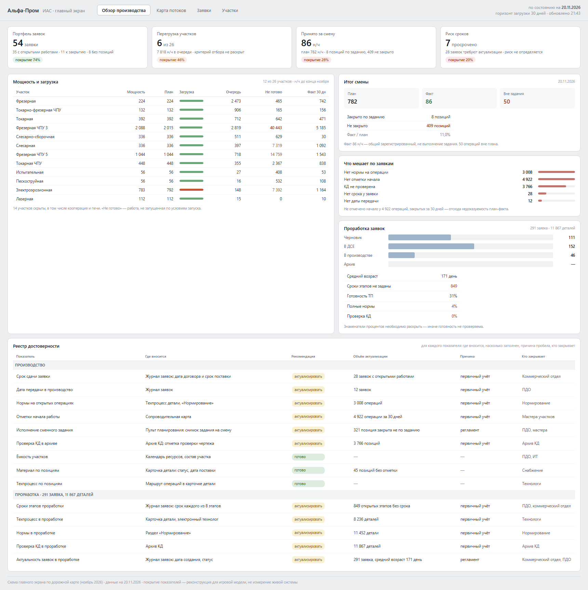
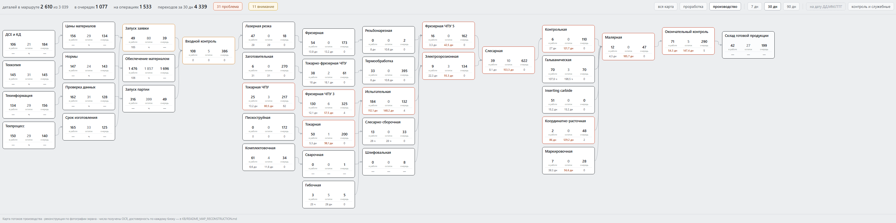

# AviaComponent — экспертиза ИАС и игровая модель предприятия

Независимая документарная экспертиза информационно-аналитической системы управления производством, плюс программная модель предприятия и модели Системы, соединяемые в игровой форме.

> **Все наименования обфусцированы.** Заказчик и его система — «Альфа-Пром», проект — «Авиакомпонент». Реальные наименования в репозитории отсутствуют.

## Что внутри

| Раздел | Содержание |
|--------|-----------|
| [`KB/`](KB/README_INDEX.md) | База знаний экспертизы: состояние контракта, соответствие ТЗ, противоречия, показатели, дорожная карта, варианты развития |
| [`SIM/`](SIM/README_Game_v1.md) | Симулятор: модель предприятия, модель Системы, три слоя экранов, спецификация первой версии |
| [`openspec/`](openspec/) | Спецификации этапов разработки |
| Первоисточники | ТЗ, описание системы, паспорт БД, ИТ-процессы, дорожная карта, снимки экранов |

## Главный вопрос проекта

**Насколько система выполнена, насколько внедрена и в каком она состоянии.**

Ответ строится в четыре уровня, которые нельзя смешивать:

| Уровень | Вопрос | Где ответ |
|---------|--------|-----------|
| 1. Поставлено ли | 5 модулей и 8 целевых состояний ТЗ реализованы? | [README_TZ_MATRIX](KB/README_TZ_MATRIX.md) |
| 2. Внедрено ли | работает в цеху или функция есть, а бумага осталась? | [README_CURRENT_STATE](KB/README_CURRENT_STATE.md) |
| 3. Работает ли корректно | даёт ли ядро воспроизводимый результат? | [README_FINDINGS](KB/README_FINDINGS.md) |
| 4. Пригодно ли для решений | можно ли на этих цифрах обещать срок? | [README_METRICS](KB/README_METRICS.md) |

Уровни 1–2 отвечают на вопрос «выполнен ли контракт». Уровни 3–4 — «можно ли этим управлять». Это разные вопросы с разными ответами.

## Ключевые выводы

- **Контракт выполнен в основном объёме.** Из восьми целевых состояний ТЗ четыре достигнуты полностью, три частично, одно нет.
- **Ядро не доказано.** Модуль маршрутных листов работает как учётный контур, но планово-расчётная часть не подтверждена: план не сохраняется как версия, снимков утверждения смен — ноль.
- **Показатели непригодны для утверждения сроков по 80% открытого портфеля:** у 28 из 35 заявок нет актуального срока.
- **Главный разрыв** — между учётными событиями и воспроизводимым управленческим решением.

## Симулятор

Проверяет, как модель Системы работает на модели Предприятия. Три слоя видимости:

| Слой | Экран |
|------|-------|
| Реальность | Цех: участки, станки, что где стоит, простои |
| Записи | Рабочие места девяти ролей |
| Свод | Главный экран руководителя |

Расхождение между слоями — предмет игры. Из наблюдаемых расхождений извлекаются требования к Системе.





## Структура

```
AviaComponent\
├── AGENTS.md            # правила работы над проектом
├── CHANGELOG.md         # история изменений
├── KB\                  # база знаний экспертизы (13 разделов)
├── SIM\                 # симулятор: спеки, схемы, код
├── openspec\            # спецификации этапов
└── первоисточники       # PDF, DOCX, JPG
```

## Статус

| Что | Состояние |
|-----|-----------|
| Экспертиза (KB) | готова: 13 разделов, реестры противоречий и несоответствий |
| Спецификация симулятора | готова: три слоя экранов, сценарии, этапы |
| Схемы | готовы: карта потоков, главный экран |
| Код | контракт, модель производства, прогон 12 смен, HTTP-сессии с версией `/v1` и клиентские типы (`SIM/`, `npm test`, `npm run api`, `npm run openapi`). Экраны — этапы 4–5 |

## Принципы работы

- **Числа — только из документов.** Не выдумывать, не доокруглять, не экстраполировать без пометки «оценка».
- **Расхождения между документами — норма.** Снимки на разные даты фиксируются оба, а не «исправляются».
- **Не переписывать историю.** Датированный документ — снимок на дату; новая оценка — новый документ.
- **Не делать Систему всеведущей.** В симуляторе расчёт показателей не читает скрытое состояние цеха.

## Лицензия и назначение

Материалы подготовлены как независимая экспертиза. Первоисточники принадлежат их владельцам и включены для обеспечения проверяемости выводов.
